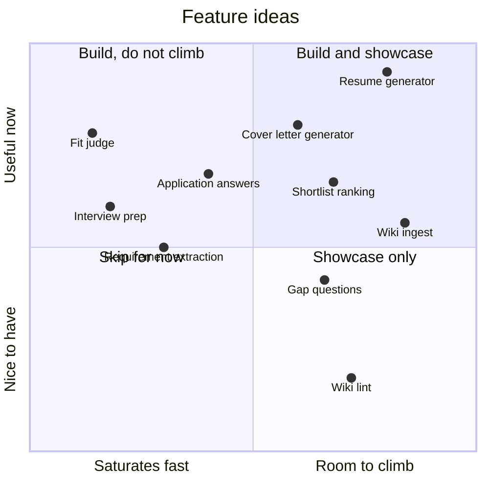

# Hills

> Ideas page. Which features are worth building, and which are worth climbing. Scores are estimates made before any baseline exists; a baseline replaces the guess.

The project has two goals that pull apart. One is a tool Trevor uses while applying for jobs. The other is a public example of eval-driven development and hillclimbing. The first feature, the fit judge, serves the tool and will probably saturate too fast to serve the example (see [[demystifying-evals]]). This page looks for features that serve both.

## Two scores

**Useful**, 1 to 5: how much it helps someone applying for jobs right now.

**Climbable**, 1 to 5: how much measurable room there is for a prompt or harness change to raise a score. A feature scores high when all four hold:

- a first attempt would fall well short
- the shortfall is the agent's, not a missing fact in the wiki or an undecided rule
- a grader can tell better from worse without Trevor reading every output
- cases are cheap enough to have a hundred or more

## The map

## The ideas

Sorted by the two scores together.

| Feature | What it does | Useful | Climbable | How it would be graded | Why it would or would not climb |
|---|---|---|---|---|---|
| **Resume generator** | Builds a resume for one posting: selects and adapts bullets, using only what the wiki supports | 5 | 4 | Code: every claim traces to a wiki quote; nothing is claimed where the fit judge said no; length. Rubric: covers the requirements the judge said yes to. Taste: blind pairwise against the previous version | Open-ended writing has real room. First drafts are generic, stuff keywords, and overclaim. The fit judge becomes part of the grader. Weak point: the taste score needs calibrating against Trevor's own picks |
| **Shortlist ranking** | Ranks a batch of postings by how much Trevor would want to apply | 4 | 3.5 | Code: rank agreement with Trevor's own ratings of a frozen batch | Labels are cheap, about 20 seconds a posting. Wanting a job depends on more than requirements, so a first attempt will miss. Risk: the misses may be preferences missing from the wiki, which no prompt change fixes |
| **Wiki ingest** | Reads a new source and proposes wiki edits for Trevor to accept | 3 | 4 | Code: every proposed claim traces to the source. Rubric: covers a list of facts Trevor says the source contains; flags contradictions with existing pages | Multi-step with real judgment: what to keep, where it goes, what it contradicts. Risk: Trevor has few real sources, so cases must be built from fictional people |
| **Fit judge** | The current plan. Yes, no or unclear per requirement, then a roll-up | 4 | 1.5 | Code: match with Trevor's labels | Easy for a current model, and the hard cases are rule decisions, not agent failures. Climb cost instead |
| **Gap questions** | Picks the few questions to ask Trevor that would settle the most unclear verdicts | 3 | 3.5 | Code: hide known facts from the wiki, see whether the questions ask for them | Cases can be generated without labelling, by removing facts. Choosing the best question from many is a real ranking problem. Less direct use |
| **Application answers** | Answers form questions ("years with X?", "describe a time you…") from the wiki | 4 | 2 | Code: quotes exist. Match with gold answers for factual ones | Factual questions saturate with a small wiki in the prompt. The story-style ones are the same problem as the resume generator |
| **Requirement extraction** | Turns a posting into a clean list of requirements | 3 | 2 | Code: overlap with Trevor's list | Needed plumbing. Probably easy; worth one baseline to confirm |
| **Interview prep** | Likely questions and matching stories from the wiki | 3.5 | 1 | No ground truth | Useful later, but nothing to grade against except taste |
| **Cover letter generator** | Drafts a letter for one posting in Trevor's voice | 4 | 3 | Same code checks as the resume generator. Rubric: addresses the posting's top requirements, names the company's actual work. Taste: blind pairwise, and closeness to `voice.md` | Common enough to matter (Trevor's correction; first scored 2.5). Room is real, but more of the score is taste, so it climbs only as far as the taste grader can be trusted |
| **Wiki lint** | Finds contradictions and stale claims in the wiki | 2 | 3.5 | Code: plant errors, count how many are found | Climbable and cheap to build cases for, but a lean wiki barely needs it |

One idea is deliberately split. **Researching new positions** has two halves: finding postings on the live web, and ranking them. The first cannot be evaluated repeatably, because the web changes between runs. The second can, on a frozen batch, and is the shortlist ranking row above.

## What this suggests

Agreed with Trevor on 2026-11-10: three features, in this order.

1. **Requisites check** (the fit judge). Expected to graduate straight to a regression suite. Useful by itself, and the next two need it as a part.
2. **Resume generator.** The showcase hill. Most useful, has room, and its grader is built from the requisites check: the first eval becomes an instrument for the second.
3. **Cover letter generator.** Reuses the resume generator's grader and adds voice.

Shortlist ranking is the fallback showcase if the taste grader proves too hard to calibrate; its grader is plain code. Everything else waits.

## Guard against scope creep

- One feature in flight at a time.
- A feature starts with a baseline, not with code. If the baseline shows no room, it is built plainly and never hillclimbed.
- A new idea goes into the table with its two scores. It does not go into the build order until something above it is done.

## A constraint on the public version

The wiki holds personal facts. A public repo cannot ship eval cases built on it. Any feature meant as a showcase needs cases built on fictional people, with the private set kept local. This also solves the small-sample problem for ingest and gap questions. **OPEN**: whether the public scores come from the fictional set alone or from both.
